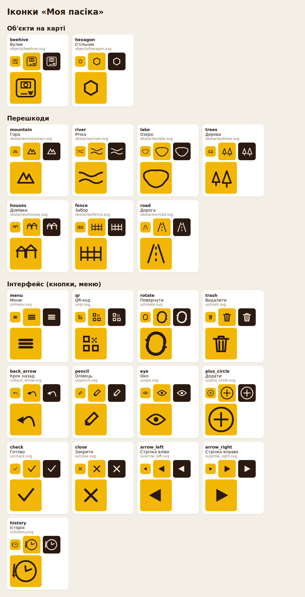

# Іконки «Моя пасіка»

Усі іконки застосунку — звичайні **SVG-файли** в цій папці. Їх можна відкривати
й малювати в Figma, Inkscape, Illustrator чи будь-якому SVG-редакторі, замінювати
файл або додавати нові — **код чіпати не потрібно**.



*(знімок на момент створення; актуальну галерею дає `python3 tool/icon_gallery.py`)*

## Структура

```
assets/icons/
├── README.md        ← цей файл
├── icons.json       ← реєстр: які іконки є, їхні назви, категорії, де вони пропонуються
├── _template.svg    ← заготовка нової іконки (файли з "_" застосунок ігнорує)
├── preview.png      ← знімок галереї для цього README
├── objects/         ← об'єкти на карті: вулик, стільник
├── obstacles/       ← перешкоди: гора, річка, озеро, дерева, домівки, забор, дорога
└── ui/              ← кнопки й меню: додати, повернути, видалити, стрілки, QR…
```

Імена файлів — **латиницею, малими літерами, `_` між словами**
(`plus_circle.svg`); ім'я файлу без `.svg` і є `id` іконки.

## Змінити наявну іконку

1. Відкрийте потрібний файл у редакторі, змініть малюнок, збережіть **під тим самим іменем**.
2. Перевірте вигляд: `python3 tool/icon_gallery.py` → відкрийте `build/icon_gallery.html`.
3. Запустіть перевірку: `flutter test test/icons_test.dart` (вона ж працює в CI на GitHub).
4. Закомітьте — нова збірка додатка візьме змінену іконку.

## Додати нову іконку

1. Скопіюйте `_template.svg` у потрібну підпапку (`objects/`, `obstacles/`, `ui/`)
   і дайте їй ім'я: `objects/queen.svg`.
2. Намалюйте іконку за правилами нижче.
3. Додайте рядок у **`icons.json`** (див. «Реєстр»).
4. Якщо створили **нову підпапку** — додайте рядок `- assets/icons/<папка>/` у
   `pubspec.yaml` (розділ `flutter → assets`) і в `categories` в `icons.json`, якщо це нова категорія.
5. `flutter test test/icons_test.dart` — тест підкаже, що забули.

## Реєстр `icons.json`

```json
{"id": "queen", "file": "objects/queen.svg", "label": "Матка", "category": "objects", "pickable": true}
```

| Поле           | Що означає |
|----------------|------------|
| `id`           | Ім'я іконки в коді й у збережених даних (малі латинські літери, цифри, `_`). **Не міняйте `id` наявних іконок** — у користувачів уже збережено вибір за цим іменем. |
| `file`         | Шлях до файлу відносно цієї папки. |
| `label`        | Назва українською (підказка в діалогі вибору). |
| `label_en`     | Необов'язково: назва англійською (інші мови - `label_<код>`). |
| `category`     | Одна з `categories` вгорі файлу (`objects`, `obstacles`, `ui`) — лише для порядку й галереї. |
| `pickable`     | `true` — іконку можна **обрати для об'єкта на карті** (діалог «Обрати іконку»). Порядок у діалозі = порядок у реєстрі. |
| `variantLabel` | Необов'язково. Якщо задано — це **вид перешкоди** у редакторі шаблонів (значення — назва в списку видів). |
| `variantLabel_en` | Необов'язково: назва виду перешкоди англійською. |

Кнопки інтерфейсу (`ui/`) у діалогах вибору не з'являються: код звертається до них
за `id` (`plus_circle`, `trash`, `check`, `menu`…). Тому їх можна **перемальовувати**,
але не перейменовувати й не видаляти.

## Правила малювання

* **Полотно 24 × 24** (`viewBox="0 0 24 24"`). Іконка масштабується до розміру кнопки/клітинки,
  тож будь-який розмір зберігає пропорції. Рекомендується залишати ~2 одиниці відступу від краю;
  іконки трохи різного розміру — це нормально, але для однієї категорії краще тримати однаковий «вигляд».
* **Колір задає застосунок**: усі кольори у файлі ігноруються, іконка малюється кольором
  теми (світлим на кнопках, темним на клітинках). Тому робіть іконку **одноколірною**;
  щоб приглушити частину — використайте `opacity` (наприклад `opacity="0.5"`).
* **Лінія** — `fill="none" stroke="currentColor"` + `stroke-width` (у наявних іконок 1,2–2,5),
  краще з `stroke-linecap="round" stroke-linejoin="round"`. Ці налаштування вже стоять на кореневому `<svg>`
  у шаблоні й успадковуються всіма елементами.
* **Суцільна фігура** — `fill="currentColor" stroke="none"` на самому елементі.
* Якщо в елемента не задано ні `fill`, ні `stroke`, він малюється як лінія; якщо задано лише `fill` — як заливка.
* **Підтримується**: `path`, `circle`, `ellipse`, `rect` (з `rx`), `line`, `polyline`, `polygon`, `g`;
  атрибути `fill`, `stroke`, `stroke-width`, `stroke-linecap`, `stroke-linejoin`, `opacity`,
  `fill-opacity`, `stroke-opacity`, також усередині `style="…"`.
* **Не підтримується**: `transform`, градієнти, `<use>`, `<defs>`, `<style>`/CSS, текст, зображення,
  маски, фільтри. Перед збереженням із редактора «розгорніть» такі речі: застосуйте перетворення до
  контурів (Inkscape: *Path → Object to Path*; Figma: *Flatten*), текст перетворіть на контури
  (*Create outlines*). Якщо щось лишилось, `flutter test test/icons_test.dart` напише, що саме.
* Не вбудовуйте растрові картинки й не залишайте видимих службових елементів
  (фон, рамка-макет): усе, що в файлі не `none`, буде намальовано.

### Поради для Figma / Inkscape

* **Figma:** фрейм 24×24, малюйте лініями (*Stroke*), перед експортом виділіть усе й натисніть *Flatten*,
  далі *Export → SVG*.
* **Inkscape:** *Document Properties* → розмір 24×24 px, масштаб 1; збережіть як *Plain SVG*.
* Обов'язково перегляньте результат у `build/icon_gallery.html` на світлому й темному тлі.

## Як це працює (для розробників)

`lib/icons/svg_icon.dart` розбирає SVG у контури Flutter (без сторонніх пакетів), `lib/icons/app_icons.dart`
читає `icons.json`, завантажує всі файли на старті (`AppIcons.load()` у `main()`) і малює їх на Canvas
кольором застосунку. Списки «іконки для об'єкта» й «види перешкод» беруться з реєстру.
